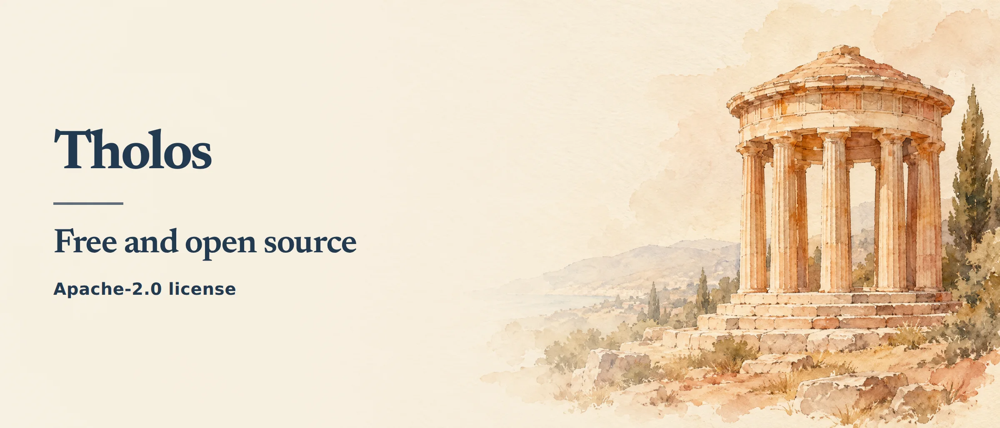

<p align="center"></p>

<p align="center">
  <a href="https://github.com/mertkayacs/tholos"></a>
  <a href="https://huggingface.co/mertkayacs/Tholos-2B"></a>
  <a href="LICENSE"></a>
  
</p>

Tholos is free and open source under the Apache-2.0 license.

<p align="center"><b>Always-on small agents share tables, notes and tasks on your own machine, with scheduled runs and allow, ask or deny rules.</b></p>

<picture><source media="(prefers-reduced-motion: reduce)" srcset="https://raw.githubusercontent.com/mertkayacs/tholos/main/docs/demo-still.webp"></picture>

[See Tholos](https://tholos.mertkayacs.com) or install it below.

## Quick start

Requires Python 3.11 or newer and a model server. For the default Tholos-2B model, install Ollama first, then run:

```sh
ollama pull hf.co/mertkayacs/Tholos-2B-GGUF:Q4_K_M && uv tool install git+https://github.com/mertkayacs/tholos && tholos
```

Open `http://127.0.0.1:7070`. In **Settings**, press **Detect** and add the model. In **Starter teams**, load **Research desk**: Scout gathers articles, Analyst scores them and Writer produces a weekly brief. The **Price watch** team checks product pages and adds a task when a price reaches your target.

The app is one Python process with a SQLite database. The default model's Q4_K_M file is about 1.6 GB and runs on a CPU.

## How work stays under your control

Each assistant has its own role, model, schedule and tools. It can edit tables and notes, search the workspace, hand tasks to teammates and ask you questions. The timeline records every tool call; workspace edits keep their author and version.

Rules allow an action, hold it for approval or deny it. Fetching a web page asks you first by default. Approval applies to the exact arguments shown to you. Conflicting writes require the assistant to read the latest version before updating it. You can answer approvals and assistant questions in the browser or connect a private Telegram chat under **Settings**.

Tholos validates each model step against the assistant's tool schema. It supports llama.cpp, Ollama and OpenAI-compatible chat completion servers. [Tholos-2B](https://huggingface.co/mertkayacs/Tholos-2B) documents model-server settings and runtime differences.

## Models

Each model turn is one JSON step containing a short thought, a tool name and its arguments. Tholos builds a schema from the assistant's allowed tools, validates the response and gives the model one retry with the validation error when a step is malformed.

llama.cpp can constrain generation with the JSON schema. Ollama receives JSON mode because it reorders schema keys, while local validation still checks every step. Each model profile has its own endpoint, model name, JSON mode and timeout. The default timeout is 120 seconds and can be changed in **Settings**.

Tholos-2B starts from MiniCPM5-2B and was fine-tuned on executed workspace tasks. Its [model card](https://huggingface.co/mertkayacs/Tholos-2B) documents the training and runtime settings, and the [Q4_K_M GGUF](https://huggingface.co/mertkayacs/Tholos-2B-GGUF) is available separately.

## Tholos-2B results

On Tholos-Bench, Tholos-2B passed **137 of 160 scenarios**, compared with **112 for MiniCPM5-2B**. Every row in the table ran on one Kaggle T4 with Q4_K_M weights, llama.cpp (CUDA build fdf5818), a 16,384-token context, JSON schema decoding, temperature 0 and the pinned benchmark clock.

Tholos-Bench contains 160 scenarios in 14 categories. It checks the final workspace state after table edits, note changes, handoffs, approvals, write conflicts, local web research, hidden instructions and tasks where the correct action is to leave the workspace unchanged.

| Model | Passed, of 160 |
| --- | ---: |
| Qwen3.5-2B | 97 |
| MiniCPM5-2B | 112 |
| Tholos-2B | 137 |
| Llama 3.2 3B Instruct | 37 |
| Granite 4.2-3B | 129 |
| Qwen3.5-4B | 141 |

Only Tholos-2B was fine-tuned for the step format. These scores measure workspace tasks in Tholos. Scores differ by runtime: Tholos-2B passed 134 with CPU llama.cpp and 136 with Ollama. Compare models within the same runtime and settings.

The [model card](https://huggingface.co/mertkayacs/Tholos-2B) gives the benchmark conditions and limits. [GGUF weights](https://huggingface.co/mertkayacs/Tholos-2B-GGUF), [training data](https://huggingface.co/datasets/mertkayacs/tholos-trajectories) and [training code](train/) are available separately.

Run the benchmark against any OpenAI-compatible model server:

```sh
tholos bench --base-url http://127.0.0.1:8080/v1 --model model-name
```

## Docker

The published container runs as an unprivileged user and stores its database in a named volume:

```sh
docker run -d --name tholos -p 127.0.0.1:7070:7070 -v tholos:/data \
  --add-host=host.docker.internal:host-gateway ghcr.io/mertkayacs/tholos
docker logs tholos
```

The log prints the access token. Add a model server from **Settings** with a URL the container can reach, such as `http://host.docker.internal:11434/v1`. Ollama listens on `127.0.0.1` by default, so its bind address must be reachable from the container first.

## Security

Tholos listens on loopback by default. Keep it there for local use. It checks request hosts, same-origin requests and form CSRF tokens. Retrieved pages are labelled as untrusted input; web fetches are restricted to public HTTP and HTTPS addresses on ports 80 and 443. Only you can change approval rules.

The database stores API keys and the Telegram token, with file access restricted to your user; the UI masks them. Review approvals and model-server settings before enabling a recurring team.

## Cite this

```bibtex
@software{kaya2026tholos,
  author = {Mert Kaya},
  title = {Tholos: Local workspace for small AI assistants},
  year = {2026},
  license = {Apache-2.0},
  url = {https://github.com/mertkayacs/tholos},
  version = {0.1.2}
}
```

## Links

- Project site: https://tholos.mertkayacs.com
- Tholos-2B model: https://huggingface.co/mertkayacs/Tholos-2B
- Tholos-2B GGUF: https://huggingface.co/mertkayacs/Tholos-2B-GGUF
- Tholos-Bench: https://huggingface.co/datasets/mertkayacs/tholos-bench
- Tholos trajectories: https://huggingface.co/datasets/mertkayacs/tholos-trajectories
- Eschatia Labs: https://eschatialabs.com
- Mert Kaya: https://mertkayacs.com

## License

[Apache-2.0](LICENSE).

<a href="https://eschatialabs.com"><picture><source media="(prefers-color-scheme: dark) and (min-resolution: 2dppx)" srcset="https://eschatialabs.com/brand/lockup-46-dark@2x.png"><source media="(prefers-color-scheme: dark)" srcset="https://eschatialabs.com/brand/lockup-46-dark@1x.png"><source media="(min-resolution: 2dppx)" srcset="https://eschatialabs.com/brand/lockup-46@2x.png"></picture></a><br>An [Eschatia Labs](https://eschatialabs.com) project by [Mert Kaya](https://mertkayacs.com).
