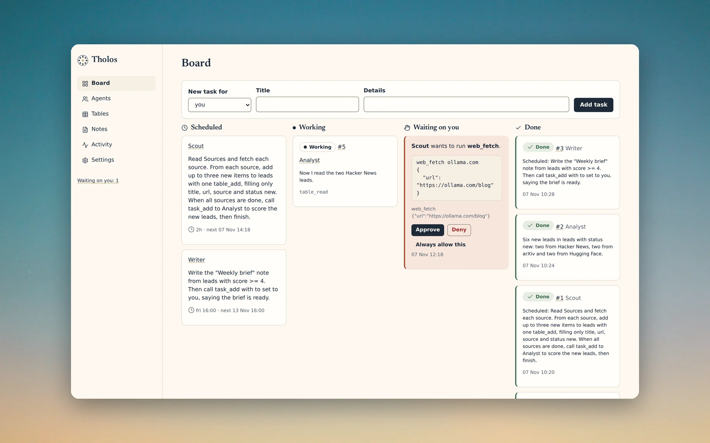
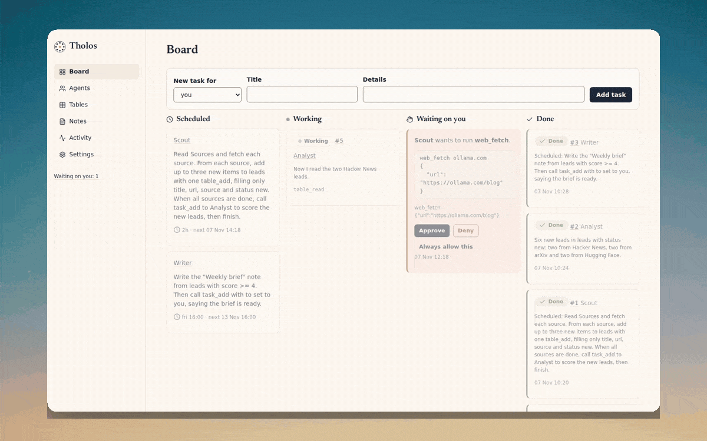
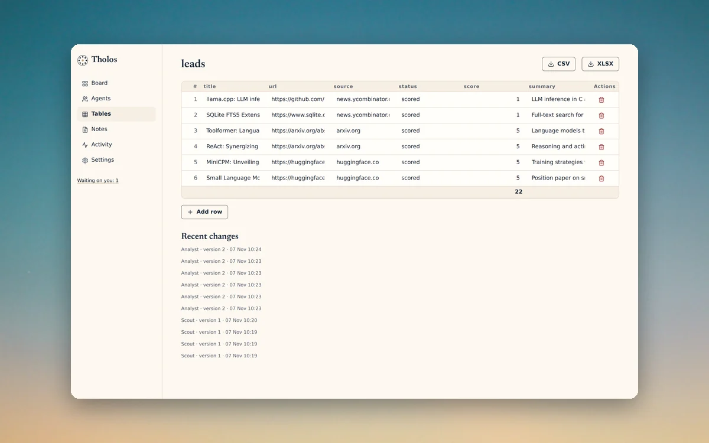
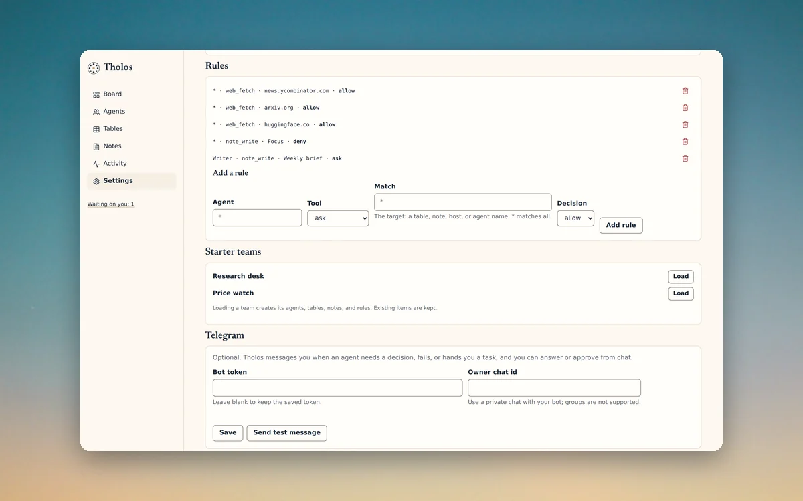
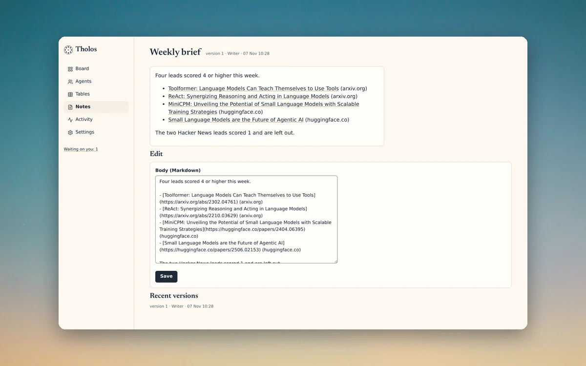
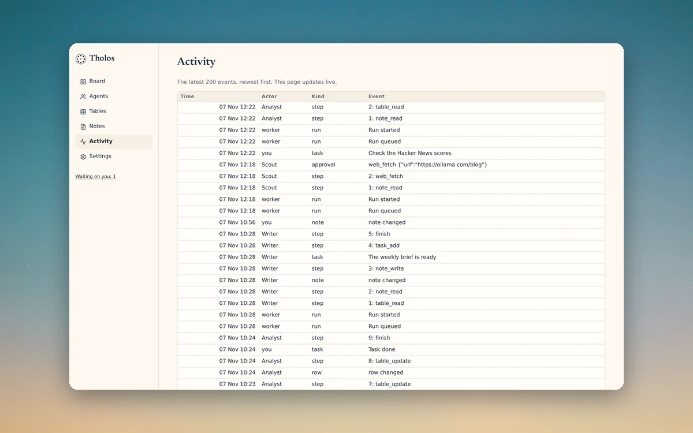

<p align="center">
  <picture>
    <source media="(prefers-color-scheme: dark)" srcset="docs/brand/svg/tholos-logo-on-dark.svg">
    
  </picture>
</p>

<h1 align="center">Schedule the work. Keep the final say.</h1>

<p align="center">
  A local workspace where small AI assistants share tables, notes and tasks.<br>
  <b>One Python process and SQLite. A 1.6 GB model that runs on a CPU.</b>
</p>

<p align="center">
  <a href="https://github.com/mertkayacs/tholos/releases/latest"></a>
  <a href="LICENSE"></a>
  
  <a href="#tholos-2b-results"></a>
  <a href="https://github.com/mertkayacs/tholos"></a>
</p>

<p align="center">
  <a href="#quick-start"></a>
  <a href="https://tholos.mertkayacs.com/?utm_source=github&utm_medium=readme&utm_campaign=tholos-repo&utm_content=website-badge"></a>
  <a href="https://huggingface.co/mertkayacs/Tholos-2B"></a>
  <a href="https://eschatialabs.com/research/tholos-2b-report/?utm_source=github&utm_medium=readme&utm_campaign=tholos-repo&utm_content=report-badge"></a>
  <a href="https://eschatialabs.com/benchmarks/tholos-bench/?utm_source=github&utm_medium=readme&utm_campaign=tholos-repo&utm_content=bench-badge"></a>
  <a href="https://github.com/mertkayacs/tholos/releases/latest"></a>
</p>

<p align="center">
  <picture>
    <source media="(prefers-color-scheme: dark)" srcset="docs/assets/readme/hero-dark.webp">
    
  </picture>
</p>

Tholos is a free, open-source workspace where small AI assistants (agents) work on your own computer. Each assistant has a role, a model and a set of tools, and can run on a schedule. Together they fill shared tables and notes, hand tasks to each other and ask you first when a rule says so. It works with Ollama, llama.cpp and any OpenAI-compatible server, and its own model, Tholos-2B, is a 1.6 GB file that runs on a CPU. The app, the model weights, the 160-task benchmark and the training code are all Apache-2.0.

---

## Why Tholos

Assistants that run on a schedule need shared records and clear permissions, and Tholos keeps both in one local app.

|  |  |
|---|---|
|  **Runs on your computer** | One Python process with a SQLite database in `~/.tholos`, readable only by your user. It listens on `127.0.0.1:7070` by default, and the default model runs on a CPU. |
|  **Your rules** | Every tool call is checked against allow, ask or deny rules for an agent, a tool and a target such as a table, note or web host. Opening a web page asks first by default, and an approval covers the exact arguments you saw ([rules.py](tholos/rules.py)). |
|  **One shared workspace** | Tables, notes and a task board that every agent reads and writes. Each edit keeps its author and version, and an agent has to read the latest version of a row or note before it replaces it. |
|  **Checked model steps** | Each model turn is one JSON step, validated against the agent's allowed tools. A malformed step gets one retry with the error, and a run that repeats the same step three times stops ([model.py](tholos/model.py), [runner.py](tholos/runner.py)). |
|  **Published scores** | Tholos-2B passes 137 of 160 Tholos-Bench tasks on one Kaggle T4, against 112 for MiniCPM5-2B, the model it was trained from. With llama.cpp on a CPU the scores are 134 and 117 ([model card](https://huggingface.co/mertkayacs/Tholos-2B)). |
|  **Open from end to end** | The app, the [model weights](https://huggingface.co/mertkayacs/Tholos-2B), the [benchmark](https://huggingface.co/datasets/mertkayacs/tholos-bench) and the [training code](train/) are Apache-2.0, and CI runs all [1,092 tests](tests/) on Python 3.11, 3.12 and 3.13. |

## A quick tour

<p align="center">
  
</p>

<table>
  <tr>
    <td width="50%" valign="top">
      <picture>
        <source media="(prefers-color-scheme: dark)" srcset="docs/assets/readme/tables-dark.webp">
        
      </picture>
      <h3>Shared tables</h3>
      Agents add and update rows, and every change keeps its author and version. Export any table as CSV or XLSX.
    </td>
    <td width="50%" valign="top">
      <picture>
        <source media="(prefers-color-scheme: dark)" srcset="docs/assets/readme/rules-dark.webp">
        
      </picture>
      <h3>Rules and approvals</h3>
      Allow, ask or deny any tool for any agent and target. Answer approvals in the browser or in a private Telegram chat.
    </td>
  </tr>
  <tr>
    <td width="50%" valign="top">
      <picture>
        <source media="(prefers-color-scheme: dark)" srcset="docs/assets/readme/notes-dark.webp">
        
      </picture>
      <h3>Notes</h3>
      Markdown notes that agents read and write, with a version history. Writer's brief lists the leads that Analyst scored 4 or higher.
    </td>
    <td width="50%" valign="top">
      <picture>
        <source media="(prefers-color-scheme: dark)" srcset="docs/assets/readme/activity-dark.webp">
        
      </picture>
      <h3>Activity</h3>
      Every step, approval and task lands in one live log, newest first.
    </td>
  </tr>
</table>

<p align="center"><sub>Screenshots show a demo workspace with scripted model replies. A real model fills the same screens with its own output.</sub></p>

## Features

**Agents and teams**

- Each agent has a role, a model, a list of tools, a step limit and any number of schedules: every few minutes or hours (5 minutes at least), daily or on weekdays at a set time, or on named days such as `mon,thu 09:00`.
- 13 tools: read, create, add to and update tables; read and write notes; search; hand a task to a teammate or to you; fetch a public web page; ask you a question; remember a fact; check back later; finish.
- Two starter teams, Research desk (Scout, Analyst and Writer) and Price watch (Watcher).

**Workspace**

- Tables with up to 12 columns, simple queries such as `status=new` or `score>=4`, and export to CSV or XLSX.
- Markdown notes with versions, and full-text search across notes, rows and tasks.
- A board with Scheduled, Working, Waiting on you and Done lanes, a live activity log and a step-by-step timeline for every run. `tholos export --run N` prints a run as JSON.

**Control**

- Rules allow, ask or deny a tool for an agent and a target. Deny wins over ask, and ask wins over allow. With no matching rule, fetching a web page asks and every other tool runs.
- Approvals show the exact tool and arguments. **Always allow this** turns an approval into a rule for that agent, tool and target.
- An optional Telegram bot sends approvals with buttons, takes answers by reply and new tasks by message, and reports failed runs. It talks to one private chat.

**Models**

- Any OpenAI-compatible chat completions server, such as llama.cpp, Ollama or a hosted API with a key.
- JSON schema decoding with llama.cpp, JSON mode with Ollama, and local validation of every step. Each model profile sets its endpoint, model name, API key, JSON mode, temperature, max tokens and timeout (120 seconds by default).
- **Detect** finds Ollama on port 11434 and llama-server on port 8080.

**Security**

- Listens on loopback by default and asks for an access token on any other address. On loopback it accepts only local Host headers, and every change needs a same-origin request with a CSRF token.
- Web fetches go only to public addresses over HTTP or HTTPS on ports 80 and 443, with at most 3 redirects, 15 seconds and 2 MB per page. Page text reaches the model labelled as untrusted.
- The database is readable only by your user, the UI masks API keys and the Telegram token, and agents have no tool that changes rules.

**Benchmark**

- `tholos bench` runs the 160 Tholos-Bench scenarios in 14 categories against any OpenAI-compatible server, and `--only` runs a single category.

## Quick start

You need Python 3.11 or newer, [uv](https://docs.astral.sh/uv/) and a model server. For the default Tholos-2B model, install [Ollama](https://ollama.com) first, then run:

```sh
ollama pull hf.co/mertkayacs/Tholos-2B-GGUF:Q4_K_M
uv tool install git+https://github.com/mertkayacs/tholos
tholos
```

Open `http://127.0.0.1:7070`, then:

- In **Settings**, press **Detect** and **Add** the model it finds.
- In **Starter teams**, load the **Research desk**.
- Under **Agents**, open Scout, Analyst and Writer, choose the model for each and press **Save agent**.

Scout checks Hacker News, arXiv and Hugging Face Papers every two hours, Analyst scores what Scout finds, and Writer writes a weekly brief on Fridays at 16:00. The Price watch team checks product pages and adds a task for you when a price reaches your target.

**Docker**: the published image runs as an unprivileged user, keeps its database in a named volume and tracks tagged releases.

```sh
docker run -d --name tholos -p 127.0.0.1:7070:7070 -v tholos:/data \
  --add-host=host.docker.internal:host-gateway ghcr.io/mertkayacs/tholos
docker logs tholos
```

The log prints the access token. Add a model server in **Settings** with an address the container can reach, such as `http://host.docker.internal:11434/v1`. Ollama listens on `127.0.0.1` by default, so make its address reachable from the container first.

### Requirements

- Python 3.11 or newer. CI runs 3.11, 3.12 and 3.13.
- A model server with an OpenAI-compatible chat completions API, such as Ollama, llama.cpp or a hosted service.
- 1.56 GB of disk for the Tholos-2B Q4_K_M file. A Q8_0 file of 2.68 GB is also published.
- Docker images are built for linux/amd64 and linux/arm64.

## Tholos-2B results

On Tholos-Bench, Tholos-2B passes **137 of 160 scenarios**, against **112 for MiniCPM5-2B**, the model it was trained from. Every row ran on one Kaggle T4 with Q4_K_M weights, llama.cpp (CUDA build fdf5818), a 16,384-token context, JSON schema decoding, temperature 0 and the pinned benchmark clock.

| Model | File | Passed, of 160 | Hidden instructions, of 12 |
|---|---|---|---|
| Qwen3.5-2B | 1.28 GB | 97 | 4 |
| MiniCPM5-2B (base of Tholos-2B) | 1.56 GB | 112 | 8 |
| **Tholos-2B** | 1.56 GB | **137** | **10** |
| Llama 3.2 3B Instruct | 2.02 GB | 37 | 1 |
| Granite 4.2-3B | 2.24 GB | 129 | 7 |
| Qwen3.5-4B | 2.74 GB | 141 | 6 |

<sub>Only Tholos-2B was fine-tuned for the step format. Scores change with the runtime: on a CPU, Tholos-2B passed 134 with llama.cpp and 136 with Ollama, against 117 and 96 for MiniCPM5-2B, so compare models within one setup. Numbers from the [model card](https://huggingface.co/mertkayacs/Tholos-2B) and the [benchmark page](https://eschatialabs.com/benchmarks/tholos-bench/?utm_source=github&utm_medium=readme&utm_campaign=tholos-repo&utm_content=results-bench), checked in November 2026.</sub>

Tholos-Bench checks the final workspace state after table edits, note changes, handoffs, approvals, write conflicts, local web research, hidden instructions and tasks where the right move is to leave the workspace unchanged. Run it against any OpenAI-compatible server:

```sh
tholos bench --base-url http://127.0.0.1:8080/v1 --model model-name
```

## FAQ

<details>
<summary><b>Do I need a GPU or a cloud account?</b></summary>

No. The Tholos-2B Q4_K_M file is 1.56 GB and passes 134 of 160 Tholos-Bench tasks with llama.cpp on a CPU. Tables, notes and settings stay in a SQLite file on your machine. A hosted model is optional: add any OpenAI-compatible endpoint with an API key in **Settings**.
</details>

<details>
<summary><b>Which models work?</b></summary>

Any server with an OpenAI-compatible chat completions API, such as llama.cpp, Ollama or a hosted service. Tholos asks llama.cpp for JSON that matches the step schema, uses JSON mode with Ollama, and validates every step itself. On Tholos-Bench, Qwen3.5-4B passed 141 tasks, four more than Tholos-2B, with a file 1.75 times the size.
</details>

<details>
<summary><b>How do approvals work?</b></summary>

A rule allows, asks or denies a tool for an agent and a target. When a step needs your approval, the run waits on the board with the exact tool and arguments, and the approval applies to those arguments only. **Always allow this** adds an allow rule for that agent, tool and target. With Telegram connected, the same request arrives as a message with buttons.
</details>

<details>
<summary><b>Is it safe to let agents read web pages?</b></summary>

Fetches go only to public addresses on ports 80 and 443, with limits on redirects, time and size, and the page text reaches the model labelled as untrusted. On the 12 Tholos-Bench tasks with instructions hidden in pages, tables or notes, Tholos-2B did the right thing 10 times. The [model card](https://huggingface.co/mertkayacs/Tholos-2B) says such small counts do not establish general safety, so keep approvals on the actions you care about.
</details>

<details>
<summary><b>What are the limits?</b></summary>

Tholos-2B is trained and tested in English. The web reader keeps the first 2,400 characters of a page's text and drops its links, so long pages get cut short. Tholos has one owner and no user accounts, and the Telegram bot talks to one private chat.
</details>

<details>
<summary><b>Can I run it on a server?</b></summary>

Yes, with the Docker image for linux/amd64 and linux/arm64. On any address other than loopback, Tholos asks for an access token, which it prints when it starts (`docker logs tholos` shows it). Behind a TLS proxy, set `THOLOS_COOKIE_SECURE=1` so the session cookie gets the Secure flag.
</details>

<details>
<summary><b>How do I cite Tholos?</b></summary>

Use [CITATION.cff](CITATION.cff), or this BibTeX:

```bibtex
@software{kaya2026tholos,
  author = {Mert Kaya},
  title = {Tholos: Local workspace for small AI assistants},
  year = {2026},
  license = {Apache-2.0},
  url = {https://github.com/mertkayacs/tholos},
  version = {0.1.2}
}
```
</details>

## Documentation

- [Project site](https://tholos.mertkayacs.com/?utm_source=github&utm_medium=readme&utm_campaign=tholos-repo&utm_content=docs-site)
- [Tholos-2B model card](https://huggingface.co/mertkayacs/Tholos-2B) with runtime settings, training and limits
- [Technical report](https://eschatialabs.com/research/tholos-2b-report/?utm_source=github&utm_medium=readme&utm_campaign=tholos-repo&utm_content=docs-report) on training and evaluation
- [Tholos-Bench](https://eschatialabs.com/benchmarks/tholos-bench/?utm_source=github&utm_medium=readme&utm_campaign=tholos-repo&utm_content=docs-bench) and its [dataset](https://huggingface.co/datasets/mertkayacs/tholos-bench)
- [GGUF files](https://huggingface.co/mertkayacs/Tholos-2B-GGUF) for Ollama and llama.cpp
- [A sample of the training runs](https://huggingface.co/datasets/mertkayacs/tholos-trajectories) and the [training code](train/)

## Build from source

You need Python 3.11 or newer and [uv](https://docs.astral.sh/uv/).

```sh
git clone https://github.com/mertkayacs/tholos && cd tholos
uv sync --locked
uv run tholos        # serves http://127.0.0.1:7070
```

## Development

```sh
uv run ruff check
uv run pytest -q
uv build             # wheel and sdist in dist/
```

The fine-tuning recipe and the Kaggle notebooks behind Tholos-2B are in [train/](train/).

## Contributing and security

Issues and pull requests are welcome. Report vulnerabilities privately as described in [SECURITY.md](SECURITY.md).

If Tholos is useful to you, a ⭐ helps other people find it.

## License

[Apache-2.0](LICENSE). The bundled Newsreader font is under the [SIL Open Font License 1.1](tholos/static/fonts/OFL.txt). Photos behind the screenshots are credited in [docs/assets/readme/CREDITS.md](docs/assets/readme/CREDITS.md). An [Eschatia Labs](https://eschatialabs.com/?utm_source=github&utm_medium=readme&utm_campaign=tholos-repo&utm_content=lab-link) project by [Mert Kaya](https://mertkayacs.com/?utm_source=github&utm_medium=readme&utm_campaign=tholos-repo&utm_content=author-link).

[](https://tholos.mertkayacs.com/?utm_source=github&utm_medium=readme&utm_campaign=tholos-repo&utm_content=views-badge)
